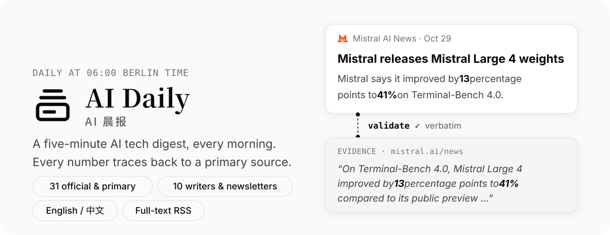
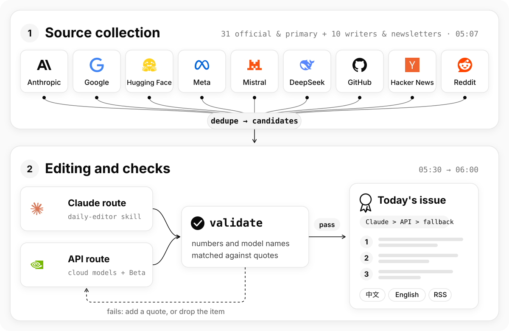

<div align="center">

<picture>
  <source media="(prefers-color-scheme: dark)" srcset="docs/assets/readme/hero-en-dark.svg">
  
</picture>

<!-- [](https://github.com/MichaelChennn/ai-daily/actions/workflows/pages.yml) -->
[](https://michaelchennn.github.io/ai-daily/en/)
[](https://michaelchennn.github.io/ai-daily/feed.en.xml)
[](https://github.com/MichaelChennn/ai-daily/tree/main/.claude/skills/daily-editor)
[](LICENSE)
[](https://creativecommons.org/licenses/by-nc/4.0/)

**English** · [简体中文](README.zh-CN.md)

</div>

## 01 Features

- **Every number has a source**: items come from 31 official and primary sources, plus 10 writers and newsletters. Every number, model name and version in an item has to appear in its sources or their verbatim evidence quotes. If one doesn't, the whole item is dropped, never "fixed".
- **Two editor routes**: Claude and cloud model APIs each edit the issue every day. Claude's edit takes priority as the main issue, and the API edit is shown next to it as a Beta. If both fail, a fallback issue with only titles and links goes out.
- **Chinese and English**: the English edition keeps the main issue's items and evidence and is written straight from the English originals, not translated.
- **Full-text RSS and archive**: [English RSS](https://michaelchennn.github.io/ai-daily/feed.en.xml), [Chinese RSS](https://michaelchennn.github.io/ai-daily/feed.xml); the website has the archive and fetch stats for every source.

## 02 Pipeline

<picture>
  <source media="(prefers-color-scheme: dark)" srcset="docs/assets/readme/pipeline-en-dark.svg">
  
</picture>

Every day, Berlin time: fetch and dedupe at 05:07, both routes start editing at 05:30, and the issue that passes `daily validate` goes out at 06:00. If nothing has passed by 06:30, the fallback goes out.

Details, in Chinese: [docs/pipeline.md](docs/pipeline.md) (fetching, dedup, the quality gate) and [docs/operations.md](docs/operations.md) (schedule, publishing, website). Why two routes: [ADR 0001](docs/adr/0001-two-editor-routes.md).

## 03 Quick start

Needs Python 3.11+ and [uv](https://docs.astral.sh/uv/); the website also needs Node 24.

```bash
uv sync                                            # create .venv from uv.lock
uv run python -m daily fetch                       # fetch today's issue → data/YYYY-MM-DD/candidates.json
uv run python -m daily list                        # browse the candidates
uv run python -m daily validate --check-links      # check digest.json
uv run python -m daily render                      # digest.json → digest.md

cd web && npm ci && npm run dev                    # local site: http://localhost:4321/ai-daily/
```

The Claude route runs as `/daily-editor 2026-10-30` in Claude Code. Every command, environment variable and the API route are in [docs/cli.md](docs/cli.md) (in Chinese).

## 04 Project structure

<details>
<summary>Show the tree</summary>

```
daily/              Python pipeline (python -m daily)
  fetchers/         one fetcher per kind of source
  dedup.py          three-level dedup
  digest.py         digest.json schema and validate
  api_editor.py     the API route
  publish.py        which edit becomes the main issue
  export.py         issues, sources and RSS → website data
web/                Astro website
data/YYYY-MM-DD/    each issue's candidates and digests (Chinese, English, Beta)
sources.yaml        the source list
.claude/skills/daily-editor/   editing rules (shared by both routes)
.github/workflows/  fetch, edit, ingest, fallback, deploy
docs/               developer docs, ADRs, research
```

</details>

Terms are defined in [GLOSSARY.md](GLOSSARY.md); the project charter is [docs/charter/00_Project_Charter.md](docs/charter/00_Project_Charter.md) (both in Chinese).

## 05 Sources

Listed in [`sources.yaml`](sources.yaml). The website's [sources page](https://michaelchennn.github.io/ai-daily/en/sources/) shows each source's fetch stats over the last 30 issues.

<details>
<summary>Show the source list</summary>

| Kind | Sources |
|---|---|
| Official blogs | OpenAI, Anthropic News / Research, Claude Blog, Google DeepMind, Google AI, Google Research, Microsoft Research, Apple ML Research, Ai2, Mistral, Hugging Face, Meta AI, xAI, Cohere, Cursor, Liquid AI, Black Forest Labs, Stability AI, Thinking Machines, MiniMax, Kimi, DeepSeek, Qwen, ByteDance Seed, Baidu ERNIE |
| Papers | Hugging Face Daily Papers |
| Open source | GitHub Releases (14 repos including vLLM, Ollama, llama.cpp, transformers), GitHub Trending, Hugging Face Trending Models |
| Writers & newsletters | Simon Willison, Interconnects, Import AI, Latent Space, Sebastian Raschka, Andrej Karpathy, Lilian Weng, Answer.AI, Sam Altman, Ethan Mollick, Kexue.fm, Recode China AI, ChinAI |
| Community | Hacker News, Reddit (r/LocalLLaMA + r/MachineLearning) |

</details>

## 06 License

- Code: [MIT](LICENSE)
- Digest content (the issues under `data/` and the text on the website): [CC BY-NC 4.0](https://creativecommons.org/licenses/by-nc/4.0/). Credit and link to the original when you republish; no commercial use.
