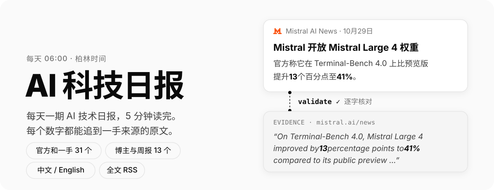
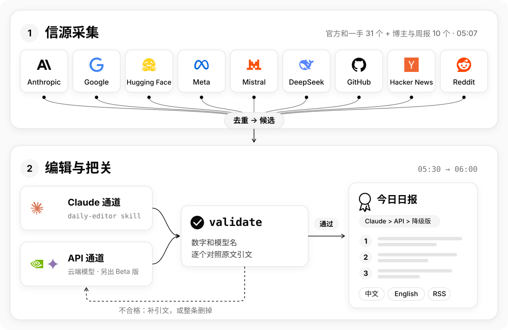

<div align="center">

<picture>
  <source media="(prefers-color-scheme: dark)" srcset="docs/assets/readme/hero-zh-dark.svg">
  
</picture>

[](https://michaelchennn.github.io/ai-daily/)
[](https://michaelchennn.github.io/ai-daily/feed.xml)
[](README.en.md)

</div>

## 01 功能

- **每个数字都有出处**：从 17 个一手信源抓取。正文里的每个数字、模型名和版本号都要能在来源和逐字摘录的 evidence 里找到，找不到就整条删掉，不做“修正”。
- **两条编辑通道**：Claude 和云端模型 API 每天各编一份。Claude 那份优先成为主版，API 那份作为 Beta 版并排展示；两条都失败时，发布只有标题和链接的降级版。
- **中英双语**：英文版沿用主版的条目和 evidence，依据英文原文直接写成，不是翻译。
- **全文 RSS 与归档**：[中文 RSS](https://michaelchennn.github.io/ai-daily/feed.xml)、[English RSS](https://michaelchennn.github.io/ai-daily/feed.en.xml)；网站上有往期归档和每个信源的抓取统计。

## 02 流水线

<picture>
  <source media="(prefers-color-scheme: dark)" srcset="docs/assets/readme/pipeline-zh-dark.svg">
  
</picture>

每天柏林时间 05:07 抓取并去重，05:30 两条通道开始编辑，`daily validate` 逐条核对后在 06:00 发布；06:30 还没有合格的日报就发布降级版。

细节见 [docs/pipeline.md](docs/pipeline.md)（抓取、去重、质量闸门）和 [docs/operations.md](docs/operations.md)（定时任务、发布、网站）。两条通道的取舍见 [ADR 0001](docs/adr/0001-two-editor-routes.md)。

## 03 快速开始

需要 Python 3.11+ 和 [uv](https://docs.astral.sh/uv/)；网站另需 Node 24。

```bash
uv sync                                            # 按 uv.lock 建好 .venv
uv run python -m daily fetch                       # 抓取今天这一期 → data/YYYY-MM-DD/candidates.json
uv run python -m daily list                        # 浏览候选
uv run python -m daily validate --check-links      # 校验 digest.json
uv run python -m daily render                      # digest.json → digest.md

cd web && npm ci && npm run dev                    # 本地网站：http://localhost:4321/ai-daily/
```

Claude 通道在 Claude Code 里运行 `/daily-editor 2026-10-30`。全部命令、环境变量和 API 通道的用法见 [docs/cli.md](docs/cli.md)。

## 04 项目结构

<details>
<summary>展开目录</summary>

```
daily/              Python 流水线（python -m daily）
  fetchers/         各类信源的抓取器
  dedup.py          三层去重
  digest.py         digest.json 的 schema 与 validate
  api_editor.py     API 通道
  publish.py        选主版的规则
  export.py         各期、信息源和 RSS → 网站数据
web/                Astro 网站
data/YYYY-MM-DD/    每期的候选、日报（中文、英文、Beta 版）
sources.yaml        信源白名单
.claude/skills/daily-editor/   编辑规则（两条通道共用）
.github/workflows/  抓取、编辑、并入、兜底、部署
docs/               开发文档、ADR、调研
```

</details>

术语表见 [GLOSSARY.md](GLOSSARY.md)，立项书见 [docs/charter/00_Project_Charter.md](docs/charter/00_Project_Charter.md)。

## 05 信源

在 [`sources.yaml`](sources.yaml) 里登记，网站的[信息源页](https://michaelchennn.github.io/ai-daily/sources/)有每个信源最近 30 期的抓取统计。

<details>
<summary>展开信源列表</summary>

| 类别 | 信源 |
|---|---|
| 官方博客 | OpenAI、Anthropic News / Research、Google DeepMind、Google AI、Mistral、Hugging Face、Meta AI、MiniMax、Kimi、DeepSeek |
| 论文 | Hugging Face Daily Papers |
| 开源 | GitHub Releases（vLLM、Ollama、llama.cpp、transformers 等 14 个仓库）、GitHub Trending、Hugging Face Trending Models |
| 社区 | Hacker News、Reddit（r/LocalLLaMA + r/MachineLearning） |

</details>

## 06 许可

- 代码：[MIT](LICENSE)
- 日报内容（`data/` 下的各期日报和网站上的文字）：[CC BY-NC 4.0](https://creativecommons.org/licenses/by-nc/4.0/deed.zh-hans)。转载请署名并链接原文，不得用于商业用途。
